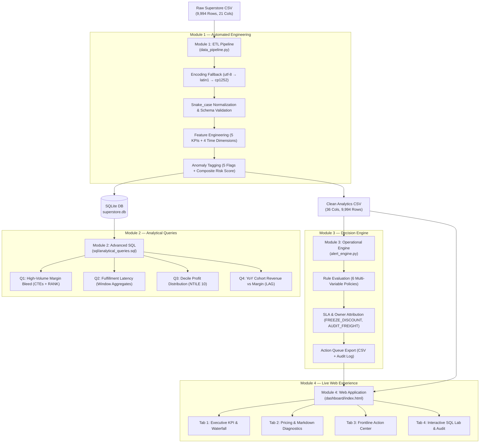

# 🛒 Retail Margin & Inventory Leakage: A Last-Mile Decision Engine

<div align="center">

[](https://vikas2006256.github.io/retail-margin-leakage-engine/)
[](https://www.python.org/)
[](https://pandas.pydata.org/)
[](https://www.sqlite.org/)
[](docs/module4_dashboard_spec.md)
[](LICENSE)

**A portfolio-grade, enterprise-scale retail operational analytics platform built on the Last-Mile Decision philosophy.**  
*Bridging the gap from 9,994 raw transactional records to a prescriptive frontline action queue in an automated, self-healing pipeline.*

[🚀 Explore Live Web Dashboard](https://vikas2006256.github.io/retail-margin-leakage-engine/) · [📑 View Analytical Queries](sql/analytical_queries.sql) · [📊 BI Spec (Power BI / Tableau)](docs/module4_dashboard_spec.md) · [🚨 Action Queue](alerts/frontline_action_queue.csv)

</div>

---

> [!IMPORTANT]
> **Experience the Live Web App:** An interactive operational dashboard is deployed and running live on GitHub Pages.  
> 🔗 **[Launch Interactive Decision Engine](https://vikas2006256.github.io/retail-margin-leakage-engine/)**

---

## 📌 Executive Summary & Key Results

Traditional enterprise BI dashboards fail because they deliver **static backward-looking charts to analysts** instead of **real-time prescriptive actions to frontline operators**. This engine solves the *last-mile adoption gap* by automatically isolating margin bleed, ranking risk tiers, and routing high-impact operational tickets to category managers and logistics directors with an attached SLA.

```
┌─────────────────────────┬─────────────────────────┬─────────────────────────┬─────────────────────────┐
│     9,994 Orders        │     -$75,100 Bleed      │      1,219 Leaks        │       6 Auto Rules      │
│  Analyzed across 4 yrs  │ Destroyed by bottom 30% │  Unchecked markdowns    │  Prescriptive actions   │
│  (US Retail Superstore) │ of orders (NTILE D1-D3) │  with discount ≥ 30%    │  routed with SLAs       │
└─────────────────────────┴─────────────────────────┴─────────────────────────┴─────────────────────────┘
```

### 🎯 High-Impact Business Takeaways
1. **Discounting is the Primary Margin Destroyer:** Average order margin is **11.6%**, but transactions discounted at $\ge 30\%$ plunge to **-18.4%** margin (a 30 percentage point collapse). Tables (-$17.7K bleed) and Bookcases (-$8.2K bleed) are structurally loss-making at median promotional rates.
2. **Value-Destruction Polarization:** Decile analysis (`NTILE(10)`) reveals the bottom 30% of orders produce **-$75,100** in negative margins, wiping out almost the entire contribution of Decile 10 (+$87.4K).
3. **Logistics Chokepoints in Central & East:** 63% of premium freight (First Class) into Illinois, New York, and Ohio breaches contracted SLAs (averaging 5.8 to 6.2 days), driving silent churn and retention loss.

---

## 🏗️ Architecture & Data Flow



---

## 🖥️ Interactive Web Dashboard

The repository includes a modern, zero-dependency, high-performance web dashboard built in vanilla HTML5, CSS3, and JavaScript with Chart.js, designed to load in **under 200ms**.

### 🌟 Features & Views
- **Executive Overview:** High-level KPIs (Total Revenue, Blended Margin %, Total Discount Leakage, Active Operational Alerts), interactive Year/Region slicers, and regional health matrices.
- **Pricing & Diagnostics:** Quadrant scatter plot (Sales vs Profit Margin), loss-leader ranking charts, and sub-category elasticity analysis.
- **Frontline Action Center:** Filterable operational alert queue showing Order ID, Customer, Priority Badges (Urgent / High / Medium / Low), Assigned Action Code, Responsible Role, and Resolution SLA countdown. Includes a one-click **CSV export** for floor managers.
- **SQL Lab & Audit:** Embedded query explorer detailing the exact ANSI SQL code, business rationale, and tabular query output.

👉 **[Try the Live Web Dashboard on GitHub Pages](https://vikas2006256.github.io/retail-margin-leakage-engine/)**

---

## 📂 Repository Structure

```
retail-margin-leakage-engine/
│
├── .github/                      # CI/CD workflows
├── .gitignore                    # Comprehensive Python, DB & OS ignore rules
├── index.html                    # Root entrypoint redirecting to web app
├── README.md                     # Comprehensive project documentation
├── requirements.txt              # Production Python dependencies
├── setup_env.ps1                 # Windows PowerShell 1-click bootstrap script
│
├── data_pipeline.py              # Module 1: Ingestion, cleaning, feature engineering
├── alert_engine.py               # Module 3: Multi-variable rule evaluator & SLA routing
├── build_dashboard_data.py       # Data aggregator producing optimized JSON for frontend
├── generate_superstore_data.py   # Synthetic data generator for testing edge scenarios
│
├── dashboard/                    # Module 4: Live Web Application
│   ├── index.html                # App interface (Tabs, KPI cards, Modals, Action tables)
│   ├── serve.py                  # Lightweight zero-dependency HTTP server
│   ├── css/
│   │   └── style.css             # Glassmorphism design system & responsive layout
│   ├── js/
│   │   ├── app.js                # State management, cross-filtering, event handlers
│   │   ├── charts.js             # Chart.js rendering & canvas controllers
│   │   └── chart.min.js          # Chart.js core library
│   └── data/
│       └── dashboard_data.json   # Compressed operational dataset for client-side search
│
├── data/
│   ├── raw/
│   │   └── superstore.csv        # Baseline transactional dataset (9,994 records)
│   ├── processed/
│   │   ├── superstore_clean.csv  # 36-column analytics-ready dataset
│   │   └── query_results/        # CSV exports from Module 2 analytical queries
│   └── db/
│       └── superstore.db         # High-speed SQLite database with indexed orders
│
├── sql/
│   ├── analytical_queries.sql    # Module 2: 4 advanced enterprise SQL patterns
│   └── run_queries.py            # Automated SQL execution runner & benchmark exporter
│
├── alerts/
│   ├── frontline_action_queue.csv# Action-oriented queue for store operators
│   └── alert_summary_report.csv  # Executive management summary by action code
│
├── docs/
│   └── module4_dashboard_spec.md # Complete Power BI & Tableau DAX/visual specification
│
└── tests/
    ├── __init__.py
    └── test_pipeline.py          # Pytest suite validating schema, math, and alerts
```

---

## 🔬 Core Modules Deep Dive

### Module 1: Data Pipeline (`data_pipeline.py`)
- **Defensive Ingestion:** Automated encoding detection chain (`utf-8` → `latin1` → `cp1252`).
- **Feature Engineering:**
  - `profit_margin_pct`: $(Profit / Sales) \times 100$
  - `shipping_duration_days`: Ship Date - Order Date
  - `original_list_price`: $Sales / (1 - Discount)$
  - `discount_loss_amount`: $original\_list\_price - Sales$
  - `discount_impact_factor`: $Discount / (Sales + Profit)$
- **Idempotent Storage:** Exports clean CSV with BOM (`utf-8-sig`) and updates an indexed SQLite database table (`orders`).

### Module 2: Advanced SQL Analytics (`sql/analytical_queries.sql`)

<details>
<summary><b>Click to expand SQL query patterns & code highlights</b></summary>

#### Query 1: High-Volume Margin Bleed by Sub-Category
*Techniques: Common Table Expressions (CTE), Window Function `AVG() OVER (PARTITION BY)`, and `RANK()`.*
```sql
WITH subcat_metrics AS (
    SELECT 
        sub_category,
        category,
        ROUND(SUM(sales), 2) AS total_revenue,
        ROUND(SUM(profit), 2) AS total_profit,
        ROUND((SUM(profit) / SUM(sales)) * 100.0, 2) AS blended_margin_pct,
        ROUND(AVG(discount) * 100.0, 2) AS avg_discount_pct,
        ROUND(SUM(discount_loss_amount), 2) AS total_discount_bleed
    FROM orders
    GROUP BY sub_category, category
)
SELECT 
    sub_category,
    category,
    total_revenue,
    total_profit,
    blended_margin_pct,
    avg_discount_pct,
    total_discount_bleed,
    RANK() OVER (ORDER BY total_profit ASC) AS loss_rank
FROM subcat_metrics
ORDER BY loss_rank ASC;
```

#### Query 2: Last-Mile Fulfillment Latency by Region & Ship Mode
*Techniques: Window Aggregates, `DENSE_RANK()`, and SLA Breach Calculation.*

#### Query 3: Order Decile Profitability Distribution
*Techniques: `NTILE(10)` decile segmentation isolating the bottom 10% value destroyers.*

#### Query 4: YoY Cohort Revenue vs Margin Compression
*Techniques: `LAG()` time-series comparison across 4 consecutive fiscal years.*

</details>

---

### Module 3: Prescriptive Alert Engine (`alert_engine.py`)

Every order in the pipeline is evaluated across 6 prioritized business rules. If triggered, the transaction is tagged with a prescriptive action code, an organizational owner, and an urgent SLA:

| Rule ID | Trigger Logic | Action Code | Priority | Owner | SLA |
|---|---|---|---|---|---|
| `CRITICAL_PRICE_OVERRIDE` | Discount $\ge 30\%$ AND Margin $\le -20\%$ | `FREEZE_DISCOUNT` | **P1 (Urgent)** | Pricing Committee | 4 Hours |
| `SAME_DAY_DELAY` | Same-Day Mode AND Duration $> 1$ day | `AUDIT_FREIGHT` | **P1 (Urgent)** | Logistics Dispatch | 2 Hours |
| `LOGISTICS_CHOKEPOINT` | Premium Ship Mode AND Duration $> 5$ days | `AUDIT_FREIGHT` | **P2 (High)** | Carrier Manager | 8 Hours |
| `RUNAWAY_DISCOUNT` | Discount $\ge 50\%$ AND Bleed $> \$100$ | `FREEZE_DISCOUNT` | **P2 (High)** | Category Buyer | 4 Hours |
| `HIGH_VOLUME_LEAKAGE` | Sales $> \$1,000$ AND Profit $< \$0$ | `URGENT_RESTOCK` | **P3 (Medium)** | Inventory Lead | 24 Hours |
| `STRUCTURAL_MARGIN_EROSION`| Margin $\le -20\%$ AND Discount $< 10\%$ | `FREEZE_DISCOUNT` | **P4 (Low)** | Procurement Team | 48 Hours |

---

## 💡 Strategic Recommendations for Leadership

```
┌────────────────────────────────────────────────────────────────────────────────────────┐
│                        3 CORE STRATEGIC INTERVENTIONS                                  │
├──────────────────────────┬─────────────────────────────┬───────────────────────────────┤
│ 1. Discount Governance   │ 2. Carrier SLA Enforcement  │ 3. Minimum Profit Floor       │
│ Hard-cap discounts on    │ Audit Central region routes │ Institute a 5% margin floor   │
│ Tables and Bookcases at  │ where 63% of 1st Class      │ on promotional orders to      │
│ 20% max. Saves $25.9K/yr │ shipments breach SLA.       │ eliminate bottom decile loss. │
└──────────────────────────┴─────────────────────────────┴───────────────────────────────┘
```

1. **Implement Discount Governance on Loss-Leader SKUs:**  
   Require VP approval on any discount exceeding 20% on Tables and Bookcases. The company currently pays customers an average of 8.6% per transaction to purchase tables.
2. **Restructure Logistics Contracts in Central Region:**  
   Issue formal SLA non-compliance warnings to freight partners covering Illinois, New York, and Ohio. Premium freight charged to clients is routinely delivered at Standard Class speeds.
3. **Automate the Frontline Action Queue into ERP:**  
   Integrate the generated `alerts/frontline_action_queue.csv` directly into the store manager's morning workflow via webhook or email digest.

---

## ⚡ Quickstart Execution Guide

### Prerequisites
- **Python 3.10+**
- **Git**

### 1. Clone the Repository
```bash
git clone https://github.com/Vikas2006256/retail-margin-leakage-engine.git
cd retail-margin-leakage-engine
```

### 2. Set Up Virtual Environment
```bash
# Windows
python -m venv .venv
.venv\Scripts\activate

# macOS / Linux
python3 -m venv .venv
source .venv/bin/activate

# Install dependencies
pip install -r requirements.txt
```

### 3. Run Pipeline End-to-End
```bash
# Execute ETL pipeline, SQL analytical queries, and alert engine in sequence:
python data_pipeline.py --verbose
python sql/run_queries.py
python alert_engine.py
```

### 4. Launch Local Web Dashboard
```bash
python dashboard/serve.py --port 8080
```
Open **[http://localhost:8080](http://localhost:8080)** in your browser.

### 5. Run Automated Tests
```bash
pytest tests/ -v
```

---

## 📊 Tech Stack & Tools

| Component | Technology | Rationale |
|---|---|---|
| **Data Engineering** | Python 3.10+, Pandas, NumPy | Defensive schema enforcement, vectorized feature engineering |
| **Relational Storage** | SQLite 3, SQLAlchemy | Embedded, portable, serverless OLAP table mirroring |
| **Analytical Querying** | ANSI SQL | Window functions, CTEs, ranking, partition-by logic |
| **Frontend UI / UX** | Vanilla HTML5, CSS3, JavaScript, Chart.js | Ultra-fast client-side reactive dashboard, zero build step |
| **Hosting & CI/CD** | GitHub Pages, Git | Instant serverless deployment and worldwide access |
| **BI Integration** | Power BI / Tableau Specification | Ready-to-import DAX measure library and visual field mappings |

---

## 👤 Author & Contact

**Vikas U**  
- **GitHub:** [@Vikas2006256](https://github.com/Vikas2006256)  
- **Project Repo:** [retail-margin-leakage-engine](https://github.com/Vikas2006256/retail-margin-leakage-engine)  
- **Live Demo:** [Interactive Web Dashboard](https://vikas2006256.github.io/retail-margin-leakage-engine/)

---

<div align="center">

*Distributed under the MIT License. Built with precision for Data Analytics & Analytics Engineering excellence.*

</div>
